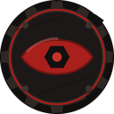

<div align="center">



# Mod Watcher

**The detailed 7 Days to Die mod-update posts from [7d2dmodding.com](https://7d2dmodding.com), delivered to your Discord server.**

Invite the official bot or self-host your own—either way, it posts mod updates and does nothing else.

[](LICENSE)
[](https://nodejs.org/)
[](https://www.typescriptlang.org/)
[](https://discord.js.org/)
[](https://7daystodie.com/)
[](https://7d2dmodding.com)

</div>

---

## 👁️ What Is This?

A small, open-source Discord bot that mirrors the **7 Days to Die** mod update feed from
[7d2dmodding.com](https://7d2dmodding.com) into your server. The heavy lifting — watching Nexus,
7daystodiemods, the official forums, CurseForge and GitHub, de-duplicating and enriching every
update — happens on 7d2dmodding.com. This bot polls one API and posts the result.

It is deliberately minimal, and the permissions prove it:

| Surface | What it asks for |
| --- | --- |
| 🛰️ Gateway intents | `Guilds` only — it never reads messages, members, or presence |
| 🔗 Invite scopes | `bot`, `applications.commands` |
| 🔒 Channel permissions | **View Channel**, **Send Messages** |
| 🏷️ Optional, for marks as reactions | **Add Reactions**, **Read Message History** |

---

## 🏷️ Marks

Every post says whether the mod was **made with generative AI** (from its Nexus tags) and **who
installs it**: the server only, each player, or both. On 7d2dmodding.com these are reactions, and
this bot does the same when it can:

- Upload three emojis to **your bot's application** in the
  [Developer Portal](https://discord.com/developers/applications) (your app → **Emojis**), named
  exactly `IsAI`, `ServerSide` and `ClientSide`. An app's own emojis work in every server it is
  in, with no extra permission for them. The bot picks them up when it starts, and every few hours
  after that.
- Give the bot **Add Reactions** and **Read Message History** in the posting channel.

Without either, the marks are written into the post instead, as a small line under the title —
`Made with generative AI (AI Media) · Server-side only`. `/status` shows which way your server
gets them.

---

## 🤝 Two Ways to Have It

- 🎟️ **Invite the official bot** — no hosting needed. It posts the feed as configured by
  7d2dmodding.com. Run `/setup channel:#your-channel` and you're done.
- 🛠️ **Self-host your own copy** — download a release (Node.js 24 is all it needs) and run it with
  your own Discord application, your own feed key, your own filters (configured on your
  7d2dmodding.com account page).

---

## ⌨️ Commands

| Command | Who | What |
| --- | --- | --- |
| `/setup channel:#…` | Manage Server | Pick the channel mod updates post in. Run with no option to check the current one. |
| `/status` | Manage Server | Ephemeral health check: last poll, last post, channel binding, running version. |
| `/collection show link:…` | everyone | Share a 7d2dmodding.com mod collection in the channel. |

That's the whole surface. Setup of *what* gets posted (filters by source, author, or mod, and
output options) lives on 7d2dmodding.com, attached to the API key.

---

## 🚀 Self-Hosting

### 1. 🤖 Create a Discord application

At <https://discord.com/developers/applications> — add a bot, copy the token.
No privileged intents are needed.

### 2. 🔑 Get a feed key

Sign in at [7d2dmodding.com](https://7d2dmodding.com) and create your API key (one per user).
Configure filters and output there too.

### 3. 📦 Download

**[⬇️ ModWatcher.zip](https://github.com/Insanity404/ModWatcher/releases/latest/download/ModWatcher.zip)**
is always the newest build. Fixed versions are on the
[Releases page](https://github.com/Insanity404/ModWatcher/releases). No cloning, no build step:

1. Install [Node.js 24](https://nodejs.org/), 24.22.1 or newer.
2. Unzip. You get a `ModWatcher` folder.
3. In it, copy `.env.example` to `.env`.
4. Fill in `DISCORD_TOKEN` and `FEED_KEY` in `.env`.
5. Run `start.cmd` (Windows, double-click works) or `./start.sh` (Linux/macOS).

The first log line shows the version you are running (`node modwatcher.mjs --version` prints it
too). To update, extract the new zip over the same folder: `.env` and `data/` are not in the
zip, so they are kept.

### 4. 📬 Invite it

Scopes `bot applications.commands`, permissions **View Channel** + **Send Messages**,
then run `/setup` in your server.

> 💡 The bot keeps one small JSON state file (`data/state.json` in its folder by default): its
> position in the feed, a short ledger of what it already posted, and each server's chosen
> channel. Delete it to reset — a fresh state starts from *now* and never back-posts history.

### 🧑‍💻 From source

Node 24 (24.22.1 or newer) and [pnpm](https://pnpm.io): `pnpm install`, `pnpm build`,
`pnpm start` (or `pnpm dev` while developing), with the same `.env`. `pnpm test` runs the tests.
`pnpm build:release` builds the release zip into `release/`, and `pnpm smoke:release` runs it
from an empty folder with a fake token to check it gets as far as the Discord login.

---

## 🧠 Behaviour Worth Knowing

- 🕐 A new install (or newly bound channel) starts with the **next** update; it does not backfill.
- 😴 If 7d2dmodding.com is unreachable, the bot backs off quietly (up to 30 min between retries).
  While it's behind, it catches up at up to 5 posts every 15 seconds until it's current. If the
  feed key hits its hourly request limit, the bot drops to the normal polling pace until it's
  current again, so once the limit resets, the Follow and changelog buttons get the rest of the
  key's hourly requests.
- 📮 If Discord has a hiccup (a server error, a dropped connection), the post is retried within a
  minute, then on each poll, and later updates wait their turn. Servers that already got it don't
  get it twice, even across a restart.
- 🛟 While no server has taken an update (Discord is down, or the bot can't reach it), the bot
  holds the update, and every update behind it, and posts them all in order once Discord takes
  posts again. A server that refuses the post (a missing permission or channel) doesn't count as
  taking it, and neither does a post Discord never answered. After a day of holding, the 5-cycle
  rule below applies to that post, so a copy that can never post moves on about one post a day,
  and posts the rest, oldest first, once it can.
- 🚧 When a server keeps failing while others take the post, the bot gives up on that post for
  that server after 5 failed cycles and logs a warning. From then on that server's failures stop
  holding later posts back, even ones no server has taken, until one goes through to it again.
- 🔁 Every send of a post carries the same nonce, and Discord drops a repeat that comes within a
  few minutes, so the retries in that first minute can't post it twice. A dropped connection or a
  server error can hide a post Discord did make, though: if Discord is still failing a minute
  later, a later retry can post it twice. A post Discord never answered at all is not sent again
  on a later cycle.
- 🤫 Failures never show up as messages in your channel. `/status` and the log are where
  problems are visible.
- 🔕 Posts can never ping anyone: every message is sent with mentions disabled.
- 🔔 The **Follow mod / Follow author** buttons and changelog **pagination** on every post work
  through 7d2dmodding.com

---

## 🏷️ Cutting a Release

Every push to `main` rebuilds `ModWatcher.zip` and refreshes the **Latest build** release, which
is the only one GitHub marks **Latest**. A version that stays downloadable for good:

1. Optionally add a `## [1.2.0]` section to `CHANGELOG.md`; it becomes the release notes.
   Without one, GitHub generates them: merged pull requests and a compare link from the
   previous version.
2. Set `"version": "1.2.0"` in `package.json`, commit, and push `main`.
3. Tag that commit and push the tag:

   ```sh
   git tag -a v1.2.0 -m "Mod Watcher 1.2.0"
   git push origin v1.2.0
   ```

The workflow publishes release **v1.2.0** with `ModWatcher-v1.2.0.zip`. A tag that does not
match `package.json` stops the run before anything is published. Push tags by name (or with
`--follow-tags`), never `--tags`: a clone collects the rolling release's old `build-…` tags, and
`--tags` would publish them again.

---

## 📜 License

[WTFPL](LICENSE). Do what you want with it. The official bot's name, avatar, and branding belong
to its application; your self-hosted copy runs under yours.

---

<div align="center">

**👁️ Happy watching. May your mods stay updated and your blood moons plentiful. 🌙**

</div>
